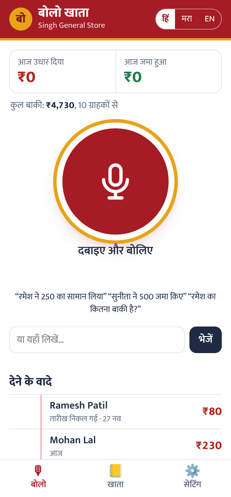
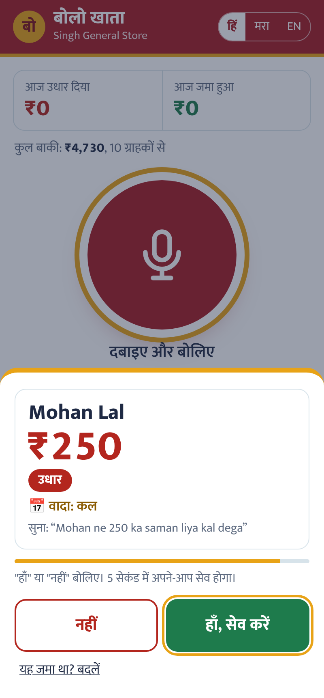
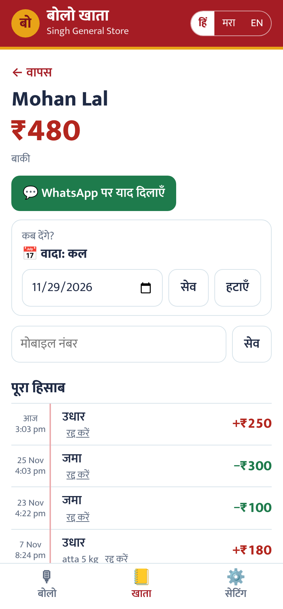

# Bolo Khata · बोलो खाता

[](https://github.com/shen947/bolo-khata/actions/workflows/ci.yml)

**A voice-first udhaar (credit) ledger for India's kirana shops.**
The shop owner taps one button and says *"Ramesh ne 250 ka saman liya"*. The app hears the name, the amount and whether it was credit or a payment, reads it back (*"Ramesh, 250 rupaye udhaar. Sahi hai?"*) and saves it. No forms, no typing, no reading.

Built for the Scaler × Wispr Flow hackathon *India Runs on Voice*. Track: **Livelihoods and small business**.

| Speak | Confirm | Customer ledger |
|---|---|---|
|  |  |  |

## Why this exists

My father runs a retail store. Every day customers pick up atta, oil or milk and say *"shaam ko de dunga"*. He's serving three other people, so the entry goes into a notebook later, half-written, or not at all. A month later nobody agrees on the balance and the money is written off.

Khata apps exist, but they're built around forms: pick a customer, type an amount, choose credit or debit, then save. That's too many steps at a busy counter, and too hard for owners who aren't comfortable typing. **Speaking one sentence takes three seconds and needs no free hands.** Here, voice is the only way the entry gets made at the moment the udhaar happens, not a feature added on top.

## What it does

| Say | What happens |
|---|---|
| `Ramesh ne 250 ka saman liya` / `रमेश ने 250 का सामान लिया` | Credit entry → spoken read-back → auto-saves in 5 s unless you say "nahi" |
| `Sunita ne 500 jama kiye` / `Sunita paid 500` | Payment entry |
| `Pappu ko 3 packet doodh diya 90 rupaye` | ₹90 credit; "3 packet doodh" kept as the note (quantity ≠ amount) |
| `Mohan ne dhai sau ka atta liya` | Number words work: dhai sau = 250, saade teen sau = 350, do hazaar paanch sau = 2500 |
| `रमेशने 300 रुपयांचे सामान घेतले` | Marathi, with glued case markers split correctly |
| `Ramesh ka kitna baaki hai?` | Speaks the balance |
| `Aaj kis kis ka udhaar hai?` | Who took credit today, with totals |
| `Sabse zyada kiska baaki hai?` | Top 5 balances |
| `Kul kitna baaki hai?` | Total pending across all customers |
| `Pichli entry cancel karo` | Cancels the last entry (kept in the audit trail) |
| `haan` / `nahi` | Confirms or rejects the card on screen |

**Built for real counters:**
- **Missing piece? It asks only for that.** *"Ramesh ne saman liya"* gets back *"Ramesh, kitne rupaye?"* and it listens again hands-free.
- **Two Rameshes?** It shows both as big buttons and asks *"Kaun se Ramesh?"*
- **Devanagari ⇄ Latin matching.** "मोहन" finds the customer saved as "Mohan Lal".
- **Unclear credit or payment?** It defaults to udhaar and *says so*. One tap switches it.
- **Mistakes:** 30-second undo toast, voice undo, and per-entry cancel. Nothing is ever hard-deleted; every change is in `/api/audit`.
- **Weak internet:** the app shell is cached (PWA). Entries spoken or typed offline are queued on the phone and processed when the network returns. Ledger data itself is never cached on the device.
- **WhatsApp reminder** in one tap, with the exact balance, in the shop's language.
- **Three languages:** Hindi, Marathi, English (UI, speech recognition and spoken replies).
- **PIN lock** (optional, Settings): once set, nobody else on the shop Wi-Fi can open the ledger. 5 wrong tries lock it.
- **Your data is yours:** download the whole ledger as CSV (opens in Excel) from Settings.

## Run it

```bash
docker compose up
```

Open **http://localhost:8000** in **Chrome** (desktop or Android) and allow the microphone. No `.env` and no API keys needed. It starts with 10 demo customers.

> Speech recognition uses the browser's Web Speech API (`hi-IN`, `mr-IN`, `en-IN`), which Chrome supports. In other browsers, use the text box under the mic; everything else works the same.

### Without Docker
```bash
cd backend
pip install -r requirements.txt
uvicorn app.main:app --reload
```

### Tests
```bash
cd backend && pip install -r requirements-dev.txt && pytest
```
65 tests cover Hindi, Hinglish, Marathi and English sentences, number words, quantity-vs-amount, follow-up questions, ambiguous names, voice undo, the full API flow, and security: PIN lock and brute-force lockout, hashed PIN and sessions, CSRF and origin checks, input limits, CSV formula injection, rate limits, headers, and LLM output validation.

CI runs the tests, **bandit** (static security analysis), **pip-audit** (known CVEs in dependencies) and a `docker compose up` smoke test on every push.

## Security and privacy

Full threat model in **[SECURITY.md](SECURITY.md)**. In short:

- **Optional PIN lock.** PBKDF2-SHA256 hashed PIN, 256-bit session tokens stored only as hashes, `HttpOnly; SameSite=Strict` cookies, brute-force lockout.
- **Strict Content-Security-Policy.** No inline scripts or styles, no third-party origins (the font is self-hosted), `frame-ancestors 'none'`, plus `nosniff`, `no-referrer` and a Permissions-Policy that allows only the microphone.
- **CSRF and abuse protection.** Writes must be JSON and same-origin, per-IP rate limits, a 16 KB body cap, and length or format limits on every field. Control and bidi characters are stripped.
- **Hardened container.** Non-root user, read-only filesystem, all capabilities dropped, `no-new-privileges`, memory and PID limits. API docs are off by default.
- **Privacy.** Audio is never recorded or stored. Data stays in one SQLite file on the shop's own machine. Entries are never hard-deleted, and every change is audited. The optional LLM only ever sees the sentence text, and its output is validated like any other untrusted input.

## Configuration (all optional)

See [`.env.example`](.env.example).

| Variable | Default | What it does |
|---|---|---|
| `SHOP_NAME` | Singh General Store | Header and WhatsApp reminder text |
| `DEFAULT_LANG` | `hi` | `hi`, `mr` or `en` |
| `SEED_DEMO` | `true` | Load 10 demo customers on first start |
| `LLM_API_KEY` | *(empty)* | Optional. Adds an LLM parser for unusual sentences; falls back to rules on any error |
| `LLM_BASE_URL` | OpenAI | Any OpenAI-compatible endpoint (Groq, OpenRouter, Sarvam, local Ollama…) |
| `LLM_MODEL` | `gpt-4o-mini` | Model name |
| `STORE_TRANSCRIPTS` | `true` | Keep the recognised sentence with each entry (audio is never stored) |
| `COOKIE_SECURE` | `false` | Set `true` behind HTTPS (Secure cookies + HSTS) |
| `TRUST_PROXY` | `false` | Trust `X-Forwarded-*` from your own reverse proxy |
| `RATE_LIMIT_PER_MIN` | `240` | API requests per minute per IP |
| `ENABLE_API_DOCS` | `false` | Interactive docs at `/docs` |
| `SESSION_DAYS` | `30` | How long a device stays unlocked after entering the PIN |

## How it works

```
 Chrome (PWA)                                   FastAPI                       SQLite
 ┌──────────────────────────┐   text + lang    ┌─────────────────────────┐   ┌──────────┐
 │ 🎙 Web Speech API         │ ───────────────▶ │ /api/interpret           │   │customers │
 │   hi-IN / mr-IN / en-IN   │                  │  rules parser (default)  │◀─▶│entries   │
 │ confirm card + 5s timer   │ ◀─────────────── │  optional LLM parser     │   │audit     │
 │ 🔊 speechSynthesis replies│  kind + reply    │  fuzzy name matcher      │   └──────────┘
 │ offline queue (local)     │                  │ /api/entries, /customers │
 └──────────────────────────┘                  └─────────────────────────┘
```

- **`backend/app/parser.py`**: a rules parser for one counter sentence. It transliterates Devanagari to a phonetic key, so a keyword list written once matches उधार, udhaar and udhar. It finds the amount (digits, Hindi/Marathi/English number words, dedh/dhai/saade/sava), the name (by case markers ne/ko/ka/la/चे, including Marathi glued suffixes), credit vs payment (with "X ko diya" vs "X ne diye" handled correctly), notes, and query intents.
- **`backend/app/lang.py`**: Devanagari → Latin transliteration with schwa deletion, plus the phonetic normaliser used for matching.
- **`backend/app/db.py`**: the ledger, balances, fuzzy customer matching (exact / ambiguous / new) and the audit trail.
- **`backend/app/replies.py`**: one-line spoken replies in Hindi, Marathi and English.
- **`backend/app/security.py`**: PIN and sessions, lockout, rate limit, CSRF/origin checks and security headers.
- **`frontend/`**: plain HTML/CSS/JS with no build step and no third-party requests. Includes the service worker (app shell only) and the self-hosted Mukta font (OFL).

### API
| Method | Path | |
|---|---|---|
| POST | `/api/interpret` | `{text, lang, context?}` → `confirm` / `clarify` / `choose` / `answer` / `undone` / `unknown` |
| POST | `/api/entries` | Save an entry (`customer_id` or `name`, `amount`, `type`) |
| POST | `/api/entries/{id}/cancel` | Cancel (soft) |
| GET | `/api/summary` | Today's credit and collections, total pending, recent entries |
| GET | `/api/customers` · `/api/customers/{id}` | Balances, history, WhatsApp reminder link |
| PATCH | `/api/customers/{id}` | Save a phone number |
| GET | `/api/audit` | Every change, ever |
| GET/PATCH | `/api/settings` | Shop name, PIN status |
| POST | `/api/auth/login` · `/logout` · `/pin` | Unlock, lock, set/change/remove PIN |
| GET | `/api/export.csv` | Whole ledger as CSV |

## Dependencies and their risks

| Dependency | Used for | Cost | Risk and mitigation |
|---|---|---|---|
| Chrome Web Speech API | Speech-to-text | Free | Needs Chrome and internet. The text box always works; next step is a pluggable STT adapter (Sarvam / Bhashini / Whisper) for offline-first Android |
| Browser speechSynthesis | Spoken replies | Free | Marathi voices are missing on some phones; falls back to the Hindi voice |
| Optional LLM | Odd sentences | ~₹0.01 per entry with a small model | Off by default; rules parser is the fallback |
| WhatsApp `wa.me` links | Reminders | Free | Owner presses send; no WhatsApp Business API needed |

## Roadmap
- Pilot at my father's store and 10 nearby shops: measure the share of udhaar captured vs the notebook, seconds per entry, and recovery of 30+ day dues.
- Android wrapper with on-device STT for no-network shops.
- Learn each shop's customer names and nicknames over time.
- Weekly "who to remind" voice summary.

## License
MIT
